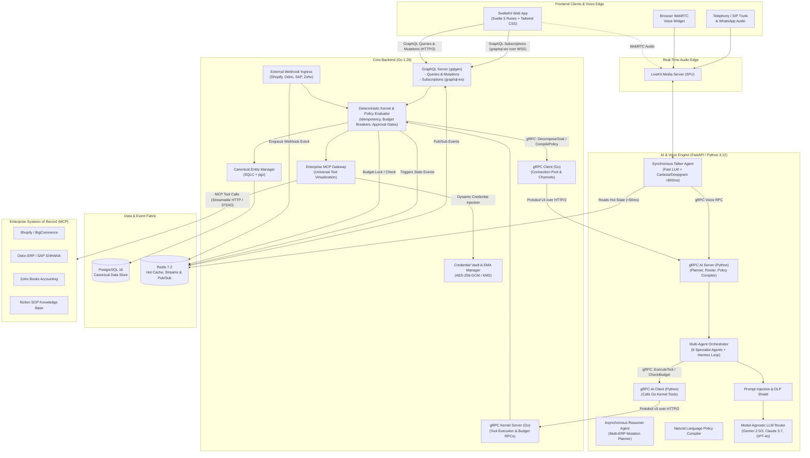

# Technical Specification (Tech Spec)
# Autonomous Business Operating System (ABOS)

**Document Version:** 2.0 (Pure gRPC & GraphQL Architecture)  
**Target Architecture:**
* **Client $\longleftrightarrow$ Backend API:** **GraphQL (Queries, Mutations & Real-Time Subscriptions via `graphql-ws`)**
* **Inter-Service Communication (Backend $\longleftrightarrow$ AI Engine):** **gRPC (Protocol Buffers v3 with Bi-Directional Streaming)**
* **AI-Related & Multi-Agent Runtime:** **FastAPI (Python 3.12+)** with `grpcio` / `grpcio-tools`
* **Core Backend, Deterministic Kernel & Ingestion:** **Go (Golang 1.26+)** with `gqlgen` & `google.golang.org/grpc`
* **Frontend Web Application:** **Svelte (SvelteKit 2 + Svelte 5 Runes)** with GraphQL Client (`@urql/svelte` / Houdini)
* **Database & Caching Layer:** **PostgreSQL 16+ (Canonical Store) & Redis 7.2+ (Hot Cache & Event Bus)**
* **Voice Transport:** **LiveKit SFU + SIP / WebRTC**

---

## 1. Executive Architecture Overview

The system strictly enforces **GraphQL** for all client-facing data interactions and **gRPC** for all internal inter-service communication. REST endpoints are eliminated from application design (external third-party webhooks from Shopify/Odoo are received at an edge ingress gateway and instantly converted into internal gRPC/GraphQL events).



---

## 2. Inter-Service gRPC Architecture (Go $\longleftrightarrow$ FastAPI)

All inter-service communication between the **Go Core Backend** and the **FastAPI AI Engine** is conducted over high-performance **gRPC** using Protocol Buffers v3 (`proto3`).

### 2.1 Protocol Buffer Definitions (`/proto/`)

#### 1. Agent Orchestrator & Planning Service (`/proto/agent_service.proto`)
Exposed by the **FastAPI AI Engine**; consumed by the **Go Core Backend**:

```protobuf
syntax = "proto3";

package abos.agent.v1;

option go_package = "github.com/mrbiz/abos/pkg/gen/agent/v1;agentv1";

service AgentOrchestratorService {
  // Decomposes high-level strategic business goals into tactical ticket milestones
  rpc DecomposeGoal (GoalDecomposeRequest) returns (GoalDecomposeResponse);

  // Streams real-time step-by-step reasoning and thought traces for an execution ticket
  rpc StreamReasoning (ReasoningRequest) returns (stream ReasoningStep);

  // Compiles human natural-language policies into deterministic JSON AST rules
  rpc CompilePolicy (CompilePolicyRequest) returns (CompilePolicyResponse);

  // Evaluates text against Prompt-Injection and Data Loss Prevention (DLP) guardrails
  rpc InspectPromptDLP (DLPInspectRequest) returns (DLPInspectResponse);

  // Triggers proactive heartbeat checks for specialist agents
  rpc RunAgentHeartbeat (HeartbeatRequest) returns (HeartbeatResponse);
}

message GoalDecomposeRequest {
  string workspace_id = 1;
  string goal_id = 2;
  string goal_description = 3;
  map<string, string> constraints = 4;
}

message MilestonePlan {
  int32 step_order = 1;
  string assigned_agent_role = 2;
  string tool_action = 3;
  string cron_schedule = 4;
  string expected_outcome = 5;
}

message GoalDecomposeResponse {
  string plan_id = 1;
  double projected_margin_pct = 2;
  int32 estimated_days = 3;
  repeated MilestonePlan milestones = 4;
}

message ReasoningRequest {
  string workspace_id = 1;
  string ticket_id = 2;
  string agent_id = 3;
  string prompt_context = 4;
}

message ReasoningStep {
  int32 step_number = 1;
  string thought = 2;
  string proposed_tool = 3;
  string tool_input_json = 4;
  bool requires_human_approval = 5;
}

message CompilePolicyRequest {
  string workspace_id = 1;
  string raw_policy_text = 2;
}

message CompilePolicyResponse {
  string rule_id = 1;
  string trigger_event = 2;
  string compiled_ast_json = 3;
  string assigned_approval_role = 4;
}

message DLPInspectRequest {
  string workspace_id = 1;
  string untrusted_content = 2;
  string origin_system = 3;
}

message DLPInspectResponse {
  bool is_safe = 1;
  string sanitized_content = 2;
  repeated string detected_pii_types = 3;
  bool injection_detected = 4;
}

message HeartbeatRequest {
  string workspace_id = 1;
  string agent_id = 2;
  string agent_role = 3;
}

message HeartbeatResponse {
  string status = 1;
  int32 tickets_spawned = 2;
  string log_summary = 3;
}
```

#### 2. Kernel Execution & Governance Service (`/proto/kernel_service.proto`)
Exposed by the **Go Core Backend**; consumed by the **FastAPI AI Engine**:

```protobuf
syntax = "proto3";

package abos.kernel.v1;

option go_package = "github.com/mrbiz/abos/pkg/gen/kernel/v1;kernelv1";

service KernelExecutionService {
  // Executes an MCP tool securely through the Go Gateway with deterministic checks
  rpc ExecuteTool (ToolExecuteRequest) returns (ToolExecuteResponse);

  // Verifies and locks idempotency key before performing operations
  rpc AcquireIdempotencyLock (IdempotencyLockRequest) returns (IdempotencyLockResponse);

  // Checks and records token/API expenditures against agent budget circuit breakers
  rpc EvaluateBudget (BudgetEvaluateRequest) returns (BudgetEvaluateResponse);

  // Logs an immutable Decision X-Ray audit record
  rpc RecordAuditLog (AuditLogRequest) returns (AuditLogResponse);
}

message ToolExecuteRequest {
  string workspace_id = 1;
  string agent_id = 2;
  string ticket_id = 3;
  string idempotency_key = 4;
  string tool_name = 5;
  string payload_json = 6;
}

message ToolExecuteResponse {
  bool success = 1;
  string status = 2; // "EXECUTED", "PENDING_APPROVAL", "CONFLICT_HOLD"
  string result_json = 3;
  string error_message = 4;
}

message IdempotencyLockRequest {
  string workspace_id = 1;
  string idempotency_key = 2;
  int64 ttl_ms = 3;
}

message IdempotencyLockResponse {
  bool acquired = 1;
  bool is_replayed = 2;
  string cached_result_json = 3;
}

message BudgetEvaluateRequest {
  string workspace_id = 1;
  string agent_id = 2;
  double estimated_cost_usd = 3;
}

message BudgetEvaluateResponse {
  bool allowed = 1;
  double spent_today_usd = 2;
  double daily_limit_usd = 3;
  bool is_circuit_broken = 4;
}

message AuditLogRequest {
  string workspace_id = 1;
  string ticket_id = 2;
  int32 step_number = 3;
  string tool_name = 4;
  string input_sanitized = 5;
  string output_sanitized = 6;
  string policy_decision = 7;
  double token_cost = 8;
  int32 latency_ms = 9;
}

message AuditLogResponse {
  bool recorded = 1;
  int64 log_id = 2;
}
```

---

## 3. Client-Facing GraphQL API Architecture (SvelteKit $\longleftrightarrow$ Go)

All interactions between the **SvelteKit Web Frontend** and the **Go Core Backend** run through **GraphQL**. 
* **Engine:** Built with `github.com/99designs/gqlgen` in Go (100% type-safe, compile-time schema validation).
* **Real-Time Subscriptions:** Served over WebSockets using the industry-standard `graphql-ws` protocol.

### 3.1 GraphQL Schema Definition (`/schema.graphql`)

```graphql
"""
Core scalar types
"""
scalar DateTime
scalar JSON
scalar Decimal

"""
Execution ticket status lifecycle
"""
enum TicketStatus {
  QUEUED
  RUNNING
  PENDING_APPROVAL
  CONFLICT_HOLD
  COMPLETED
  FAILED
}

"""
Specialist Agent Model Tiers
"""
enum ModelTier {
  FLASH
  FRONTIER
}

"""
Entity types managed across connected ERPs
"""
enum EntityType {
  SKU
  ORDER
  CUSTOMER
  INVOICE
  VENDOR
}

"""
System health status indicators
"""
enum HealthStatus {
  HEALTHY
  DEGRADED
  CRITICAL
}

# ==============================================================================
# Queries
# ==============================================================================
type Query {
  # Workspace & Settings
  workspace(id: ID!): Workspace!

  # Live Operations Board
  executionBoard(workspaceId: ID!): ExecutionBoardState!

  # Tickets & Approvals
  tickets(workspaceId: ID!, status: TicketStatus, limit: Int = 50, offset: Int = 0): [ExecutionTicket!]!
  ticket(id: ID!): ExecutionTicket!
  pendingApprovals(workspaceId: ID!): [ExecutionTicket!]!

  # Agent Workforce
  agentRoster(workspaceId: ID!): [AgentDefinition!]!
  agent(id: ID!): AgentDefinition!

  # Business Planner & Goals
  activeGoals(workspaceId: ID!): [BusinessGoal!]!
  goal(id: ID!): BusinessGoal!

  # Decision X-Ray Audit Trail
  decisionXRay(ticketId: ID!): [AuditXRayLog!]!

  # Enterprise Connections
  mcpConnections(workspaceId: ID!): [MCPConnection!]!
}

# ==============================================================================
# Mutations
# ==============================================================================
type Mutation {
  # Human Approval Actions
  approveTicket(input: ApproveTicketInput!): ExecutionTicket!
  rejectTicket(input: RejectTicketInput!): ExecutionTicket!
  modifyAndExecuteTicket(input: ModifyTicketInput!): ExecutionTicket!

  # Business Planner
  createGoal(input: CreateGoalInput!): BusinessGoal!
  triggerPlanExecution(goalId: ID!): BusinessGoal!

  # Natural-Language Policy Compiler
  compileAndSavePolicy(input: CompilePolicyInput!): PolicyRule!

  # Agent Governance
  updateAgentBudget(agentId: ID!, dailyBudgetUsd: Decimal!): AgentDefinition!
  pauseAgent(agentId: ID!): AgentDefinition!
  resumeAgent(agentId: ID!): AgentDefinition!
  triggerManualHeartbeat(agentId: ID!): Boolean!

  # Feedback Loop ("Correct Agent")
  submitAgentCorrection(input: AgentCorrectionInput!): Boolean!

  # MCP Connectors
  registerMCPConnection(input: RegisterMCPInput!): MCPConnection!
  testMCPHealth(connectionId: ID!): HealthStatus!
}

# ==============================================================================
# Real-Time Subscriptions (graphql-ws)
# ==============================================================================
type Subscription {
  # Live updates when cards transition lanes on the Execution Board
  ticketUpdated(workspaceId: ID!): ExecutionTicket!

  # High-priority alert when a ticket is held for human approval
  approvalRequested(workspaceId: ID!): ExecutionTicket!

  # Triggered when an agent reaches 80% or 100% (circuit breaker tripped)
  budgetAlertTriggered(workspaceId: ID!): BudgetAlert!

  # Live stream of active telephony / WebRTC customer calls
  liveVoiceCallActive(workspaceId: ID!): LiveVoiceCall!

  # Real-time stream of audit logs for the Decision X-Ray viewer
  auditLogAppended(ticketId: ID!): AuditXRayLog!
}

# ==============================================================================
# Types & Inputs
# ==============================================================================
type Workspace {
  id: ID!
  name: String!
  defaultCurrency: String!
  taxJurisdiction: String!
  dailySpendLimitUsd: Decimal!
  createdAt: DateTime!
}

type ExecutionBoardState {
  systemHealth: HealthStatus!
  incomingCount: Int!
  syncingCount: Int!
  reconcilingCount: Int!
  pendingApprovalsCount: Int!
  recentTickets: [ExecutionTicket!]!
}

type ExecutionTicket {
  id: ID!
  workspaceId: ID!
  goalId: ID
  assignedAgent: AgentDefinition
  status: TicketStatus!
  idempotencyKey: String!
  priority: Int!
  actionType: String!
  payload: JSON!
  result: JSON
  conflictDiff: ConflictDiff
  createdAt: DateTime!
  updatedAt: DateTime!
}

type ConflictDiff {
  entityType: EntityType!
  field: String!
  systemA: String!
  valueA: String!
  systemB: String!
  valueB: String!
}

type AgentDefinition {
  id: ID!
  roleName: String!
  modelTier: ModelTier!
  heartbeatCron: String
  dailyBudgetUsd: Decimal!
  spentTodayUsd: Decimal!
  status: String!
  playbookRef: String
}

type BusinessGoal {
  id: ID!
  title: String!
  targetMetric: String!
  targetValue: Decimal!
  currentValue: Decimal!
  projectedMarginPct: Decimal!
  deadline: DateTime!
  status: String!
  milestones: [Milestone!]!
}

type Milestone {
  id: ID!
  stepOrder: Int!
  action: String!
  assignedAgentRole: String!
  isCompleted: Boolean!
}

type AuditXRayLog {
  id: ID!
  stepNumber: Int!
  toolName: String
  inputSanitized: JSON
  outputSanitized: JSON
  policyDecision: String!
  tokenCost: Decimal!
  latencyMs: Int!
  createdAt: DateTime!
}

type MCPConnection {
  id: ID!
  serverName: String!
  transportType: String!
  serverUri: String!
  healthStatus: HealthStatus!
  allowedScopes: [String!]!
}

type BudgetAlert {
  agentId: ID!
  agentRole: String!
  spentTodayUsd: Decimal!
  dailyBudgetUsd: Decimal!
  percentageUsed: Float!
  isHardCutoff: Boolean!
}

type LiveVoiceCall {
  callId: ID!
  callerNumber: String!
  agentRole: String!
  channel: String! # SIP / WebRTC / WhatsApp
  durationSeconds: Int!
  sentiment: String!
  liveTranscriptSnippet: String!
}

type PolicyRule {
  id: ID!
  triggerEvent: String!
  compiledAstJson: JSON!
  assignedApprovalRole: String!
}

# --- Mutation Inputs ---
input ApproveTicketInput {
  ticketId: ID!
  overrideReason: String
}

input RejectTicketInput {
  ticketId: ID!
  rejectionReason: String!
}

input ModifyTicketInput {
  ticketId: ID!
  modifiedPayload: JSON!
}

input CreateGoalInput {
  workspaceId: ID!
  title: String!
  description: String!
  targetDeadline: DateTime!
  constraints: JSON!
}

input CompilePolicyInput {
  workspaceId: ID!
  rawPolicyText: String!
}

input AgentCorrectionInput {
  ticketId: ID!
  agentId: ID!
  correctionNote: String!
  updatePlaybookInNotion: Boolean!
}

input RegisterMCPInput {
  workspaceId: ID!
  serverName: String!
  transportType: String!
  serverUri: String!
  rawCredentialsJson: String! # Handled securely by Go Vault
  allowedScopes: [String!]!
}
```

---

## 4. Frontend Web Implementation (SvelteKit + Svelte 5 + GraphQL)

### 4.1 Client Architecture
* **GraphQL Client:** `@urql/svelte` or `houdini` with WebSocket exchange (`graphql-ws`).
* **State Management:** Svelte 5 Runes (`$state`, `$derived`, `$effect`).
* **WebSocket Heartbeat:** Auto-reconnect with exponential backoff on network jitter.

### 4.2 Svelte 5 Live Operations Board Example (`/src/routes/operations/+page.svelte`)

```svelte
<script lang="ts">
  import { getContextClient, subscriptionStore, mutationStore } from '@urql/svelte';
  import { flip } from 'svelte/animate';
  import { fade } from 'svelte/transition';
  import ApprovalDrawer from '$lib/components/ApprovalDrawer.svelte';
  import StatusPill from '$lib/components/StatusPill.svelte';

  const client = getContextClient();

  // GraphQL Subscriptions for real-time card transitions
  const ticketSubscription = subscriptionStore({
    client,
    query: `
      subscription OnTicketUpdated($workspaceId: ID!) {
        ticketUpdated(workspaceId: $workspaceId) {
          id
          status
          actionType
          priority
          payload
          conflictDiff {
            field
            systemA
            valueA
            systemB
            valueB
          }
        }
      }
    `,
    variables: { workspaceId: 'ws_994' }
  });

  // Reactive state using Svelte 5 Runes
  let activeDrawerTicket = $state<any>(null);
  let tickets = $state<any[]>([]);

  // Update tickets on incoming subscription events
  $effect(() => {
    if ($ticketSubscription.data?.ticketUpdated) {
      const incoming = $ticketSubscription.data.ticketUpdated;
      const index = tickets.findIndex(t => t.id === incoming.id);
      if (index !== -1) {
        tickets[index] = incoming;
      } else {
        tickets = [incoming, ...tickets];
      }
    }
  });

  // Derived lanes
  let incomingOrders = $derived(tickets.filter(t => t.status === 'QUEUED' || t.status === 'RUNNING'));
  let pendingApprovals = $derived(tickets.filter(t => t.status === 'PENDING_APPROVAL' || t.status === 'CONFLICT_HOLD'));
  let completedTickets = $derived(tickets.filter(t => t.status === 'COMPLETED'));
</script>

<div class="h-screen w-full bg-slate-950 text-slate-100 flex flex-col p-6">
  <header class="flex justify-between items-center mb-6">
    <h1 class="text-2xl font-bold tracking-tight">Autonomous Business Operating System</h1>
    <StatusPill status="HEALTHY" />
  </header>

  <div class="grid grid-cols-3 gap-6 flex-1 overflow-hidden">
    <!-- Lane 1: Incoming & Running -->
    <div class="bg-slate-900 border border-slate-800 rounded-xl p-4 flex flex-col">
      <h2 class="text-sm font-semibold text-slate-400 uppercase tracking-wider mb-3">
        Active Ingestion & Processing ({incomingOrders.length})
      </h2>
      <div class="space-y-3 overflow-y-auto flex-1">
        {#each incomingOrders as ticket (ticket.id)}
          <div animate:flip={{ duration: 300 }} class="p-3 bg-slate-800 rounded-lg border border-slate-700">
            <div class="text-sm font-medium">{ticket.actionType}</div>
            <div class="text-xs text-slate-400 mt-1">ID: {ticket.id.slice(0, 8)}</div>
          </div>
        {/each}
      </div>
    </div>

    <!-- Lane 2: Exceptions & Human Approvals -->
    <div class="bg-slate-900 border border-amber-900/40 rounded-xl p-4 flex flex-col">
      <h2 class="text-sm font-semibold text-amber-400 uppercase tracking-wider mb-3">
        Requires Approval / Conflict ({pendingApprovals.length})
      </h2>
      <div class="space-y-3 overflow-y-auto flex-1">
        {#each pendingApprovals as ticket (ticket.id)}
          <div 
            animate:flip={{ duration: 300 }} 
            class="p-3 bg-amber-950/40 border border-amber-700/60 rounded-lg cursor-pointer hover:border-amber-500 transition-colors"
            onclick={() => activeDrawerTicket = ticket}
          >
            <div class="flex justify-between items-center">
              <span class="text-xs px-2 py-0.5 rounded bg-amber-900 text-amber-200 font-medium">
                {ticket.status}
              </span>
              <span class="text-xs text-slate-400">P{ticket.priority}</span>
            </div>
            <div class="text-sm font-medium mt-2">{ticket.actionType}</div>
            {#if ticket.conflictDiff}
              <div class="text-xs text-amber-300 mt-2">
                Mismatch: {ticket.conflictDiff.systemA} vs {ticket.conflictDiff.systemB}
              </div>
            {/if}
          </div>
        {/each}
      </div>
    </div>

    <!-- Lane 3: Completed Operations -->
    <div class="bg-slate-900 border border-slate-800 rounded-xl p-4 flex flex-col">
      <h2 class="text-sm font-semibold text-emerald-400 uppercase tracking-wider mb-3">
        Completed Without Human Touch ({completedTickets.length})
      </h2>
      <div class="space-y-3 overflow-y-auto flex-1">
        {#each completedTickets as ticket (ticket.id)}
          <div animate:flip={{ duration: 300 }} class="p-3 bg-slate-800/60 border border-slate-800 rounded-lg">
            <div class="text-sm text-slate-300">{ticket.actionType}</div>
            <div class="text-xs text-emerald-400 mt-1">✓ Reconciled & Logged</div>
          </div>
        {/each}
      </div>
    </div>
  </div>

  {#if activeDrawerTicket}
    <ApprovalDrawer 
      ticket={activeDrawerTicket} 
      onClose={() => activeDrawerTicket = null} 
    />
  {/if}
</div>
```

---

## 5. Security & Governance Specification (Pure gRPC & GraphQL)

### 5.1 GraphQL Security & DoS Protection
* **Query Depth Limiting:** Max depth of **6 levels** enforced in `gqlgen` to prevent recursive schema exploitation.
* **Complexity Analysis:** Resolvers are assigned computational weights; any GraphQL query exceeding **200 complexity points** is rejected immediately.
* **Introspection Lockdown:** GraphQL schema introspection is enabled exclusively in development (`localhost`) and disabled in production.
* **Authentication & Cookie Context:**
  * SvelteKit sends HttpOnly, Secure, SameSite=Strict session cookies.
  * In Go, HTTP middleware extracts and validates the session cookie before invoking the GraphQL execution handler.
  * Context injects `WorkspaceID`, `UserID`, and `UserRole` (`owner`, `admin`, `operator`, `auditor`).

### 5.2 gRPC Inter-Service Security
* **Transport Security:** Mutual TLS (mTLS) with internal x509 certificates generated per service container.
* **Network Boundary:** The FastAPI gRPC server listens strictly on a private Docker / K8s overlay network (`127.0.0.1` in local testing) and is **never** accessible from the public internet.
* **Metadata Authentication:** Every gRPC call attaches a cryptographically signed HMAC token in the `authorization` metadata header to prevent rogue container calls.

---

## 6. Monorepo Project Structure (gRPC & GraphQL Focused)

```text
/
├── proto/                               # Source of Truth for gRPC
│   ├── agent_service.proto              # FastAPI AI Agent gRPC service
│   ├── kernel_service.proto             # Go Kernel & MCP Gateway gRPC service
│   └── voice_service.proto              # Real-Time Voice gRPC contracts
│
├── backend-core/                        # Go 1.26 Backend Service
│   ├── cmd/
│   │   └── server/main.go               # Go Entrypoint
│   ├── pkg/
│   │   ├── gen/
│   │   │   ├── agent/v1/                # protoc-gen-go generated files
│   │   │   └── kernel/v1/
│   │   ├── graphql/                     # gqlgen GraphQL Server
│   │   │   ├── schema.graphql           # GraphQL Schema
│   │   │   ├── generated.go             # Auto-generated code
│   │   │   ├── resolver.go              # Root resolver
│   │   │   └── schema.resolvers.go      # Queries, Mutations & Subscriptions
│   │   ├── grpc/
│   │   │   ├── client_ai.go             # Go client calling FastAPI gRPC
│   │   │   └── server_kernel.go         # Go server serving Kernel RPCs
│   │   ├── db/                          # SQLC queries & PostgreSQL migrations
│   │   ├── ingest/                      # Ingress webhook adapter (<250ms SLA)
│   │   ├── kernel/                      # Deterministic Idempotency & Budget Engine
│   │   └── mcp/                         # Enterprise MCP Gateway & Adapters
│   ├── go.mod
│   └── go.sum
│
├── ai-service/                          # FastAPI Python 3.12 AI Engine
│   ├── gen/
│   │   ├── agent_service_pb2.py         # grpcio-tools generated files
│   │   ├── agent_service_pb2_grpc.py
│   │   ├── kernel_service_pb2.py
│   │   └── kernel_service_pb2_grpc.py
│   ├── agents/                          # 8 Specialist Agent implementations
│   ├── grpc_server/                     # Implements AgentOrchestratorService
│   ├── grpc_client/                     # Client calling Go KernelExecutionService
│   ├── compiler/                        # Natural-Language Policy Compiler
│   ├── router/                          # Model-Agnostic LLM Router (LiteLLM)
│   ├── security/                        # Presidio DLP & Prompt Injection Shield
│   ├── voice/                           # LiveKit Talker-Reasoner voice engine
│   ├── main.py                          # Dual ASGI (FastAPI) + gRPC Server startup
│   ├── pyproject.toml
│   └── requirements.txt
│
├── frontend/                            # SvelteKit 2 + Svelte 5 Frontend
│   ├── src/
│   │   ├── lib/
│   │   │   ├── components/              # ExecutionBoard, ApprovalDrawer, OrgChart, XRay
│   │   │   ├── graphql/                 # GraphQL Client (urql/houdini) & Queries
│   │   │   └── stores/                  # Svelte 5 Runes ($state)
│   │   ├── routes/                      # SvelteKit Pages
│   │   └── hooks.server.ts              # BFF Auth & Cookie Validation
│   ├── svelte.config.js
│   ├── tailwind.config.cjs
│   └── package.json
│
├── deploy/
│   ├── docker-compose.yml
│   └── env.example
├── PRD.md                               # Product Requirements Document
└── TECH_SPEC.md                         # This Document (Pure gRPC & GraphQL)
```

---

## 7. Implementation Notes (deviations from this spec)

These record where the code intentionally differs from the text above.

* **Message names:** the checked-in protos use `ExecuteToolRequest/Response`, `AcquireIdempotencyLockRequest/Response`, `EvaluateBudgetRequest/Response`, `RecordAuditLogRequest/Response`, `DecomposeGoalRequest/Response`, `StreamReasoningRequest/Response`, `InspectPromptDLPRequest/Response` and `RunAgentHeartbeatRequest/Response`. The protos under `/proto/abos/**` are the source of truth, not the snippets in section 2.
* **Workspace IDs are UUIDs** everywhere (database, gRPC, webhooks, cache keys). The `ws_...` strings in examples are illustrative only; the Go server rejects non-UUID workspace IDs.
* **Policy rules** are matched on the *action name containing* `refund` / `discount` and are fail-closed: a missing or unparseable amount suspends the action for approval instead of allowing it.
* **gRPC auth:** every call carries `authorization: Bearer <unix-ts>.<hmac_sha256(secret, ts)>` (`ABOS_INTERNAL_SECRET`, 5 minute skew window). Mutual TLS is optional via `ABOS_TLS_CERT/KEY/CA`.
* **Auth:** the SvelteKit server (BFF) owns an HttpOnly session cookie holding an opaque random token; the Go backend stores only its SHA-256 and validates it on every call (`Authorization: Bearer`). Browsers open websockets with a 60-second single-use ticket (`POST /auth/ws-ticket`) so they never hold the session token. Roles: owner, admin (everything), operator (view, decide, operate), auditor (view only).
* **Tenant isolation** is enforced twice: every query is workspace-scoped in code, and PostgreSQL row-level security (migration 000003) enforces it again using `app.workspace_id`, set per connection acquire from the request context. Connect as the `abos_app` role (`ABOS_DB_ROLE`).
* **MCP credentials** are encrypted with AES-256-GCM (`ABOS_VAULT_KEY`), bound to the workspace as additional authenticated data, and decrypted only inside the gateway. Only the Streamable HTTP transport is supported; server URLs are validated and re-checked at connect time to block private addresses.
* **Webhook ingress** binds each source (secret + workspace) in server configuration. The workspace is never read from request headers.
* **AI service:** `ABOS_ENV` defaults to `production`. Mock LLM output, canned goal plans, fake audio and fixture data are available only with `ABOS_ENV=dev`. Dependencies not yet used by code (FastAPI, LiteLLM, Presidio, LiveKit) are not installed.
* **Audit log** (`audit_xray_logs`) is append-only at the database level (triggers block UPDATE/DELETE/TRUNCATE) and no longer cascades from ticket/workspace deletion.
